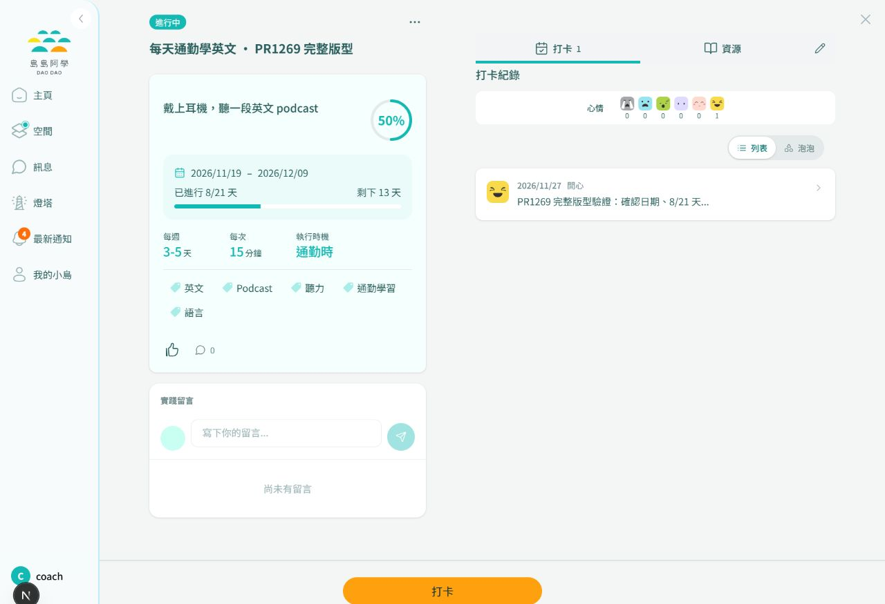
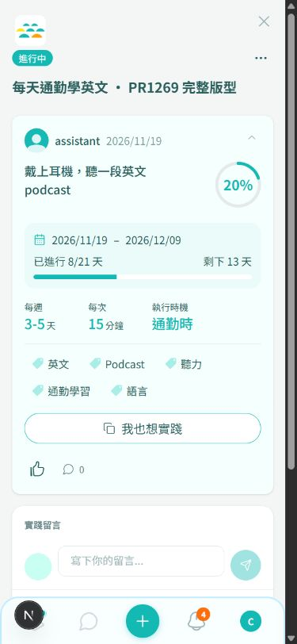
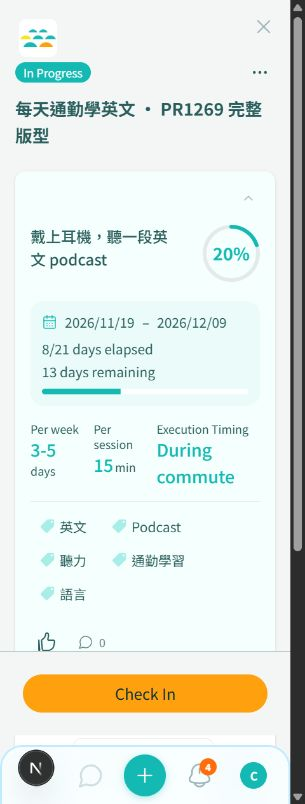

# Practice detail full overview — 2026-11-27

This follow-up adds the full overview requested in the reference screenshot to draft [PR #1269](https://github.com/daodaoedu/daodao-f2e/pull/1269), targeting `dev`. It was tested against the product source included with this report. The earlier [five-mood/API/error-path report](practice-detail-verification-2026-11-26.md) describes commit `97dd175e33eace2a642f13130fbddd714521a98e`; those broader journeys were not all repeated here.

## Implemented scope

- The expanded owner and visitor overview shows the inclusive start/end dates, elapsed/total days, remaining days, and a horizontal period-progress bar directly. The former More Info disclosure is removed.
- Per week, per session, and execution timing share a three-column row; the action, check-in progress ring and tags remain visible. Timing uses the existing translated options and custom timing.
- Period calculations reuse the shared local-calendar rules. Start day is zero elapsed; the end date is start plus duration minus one. Remaining days include today and are clamped to zero through total days. Missing/invalid dates or duration omit the period panel without inventing data.
- The horizontal bar measures elapsed calendar days, independently of the API check-in percentage in the ring. The reference's historical 7/21 and 125% values are not hardcoded: on November 27 the same November 19–December 9 range is 8/21 elapsed, 13 remaining, and 38.095% period progress.
- The existing shared Progress component now passes its bounded value to Radix, so assistive technology receives the same determinate value as the visual fill. Its existing percentage bounds remain 0–100; null/undefined retain indeterminate semantics.
- Compact owner collapse/expand behavior is retained. Creation previews that do not pass a schedule retain their existing layout. No API, schema, authorization, dependencies or production environment settings change.

## Runtime and data

Windows native adaptation of the existing local synthetic environment: task-owned product on `localhost:3003` with `--hostname localhost`, real local API on `13003`, existing PostgreSQL `15432` and Redis `16379`. The normal runtime helper is macOS/Linux Docker oriented, so no helper Doctor success is claimed. The initial cold compilation exceeded one browser navigation timeout; after compilation the actual page and subsequent routes rendered successfully.

The backend checkout was the existing older local `668c2eaa…` checkout with unrelated integration changes; this is not evidence for deployed-dev compatibility. No local login bypass was added. Existing browser authentication identified synthetic owner `dcc0af58-97f2-4039-b849-4d061daeda63`; a different synthetic owner, `e6b133ea-4aeb-4de6-8d2a-5ed96a2a6934`, supplied the true visitor fixture. No fault proxy was used in this run.

| Fixture | External ID | Dates |
| --- | --- | --- |
| Owner, new full overview | `d8aef5b1-3084-418a-a75d-e06095b50cb8` | 2026-11-19–2026-12-09, 21 days |
| Different owner's public practice | `c8057643-b70b-4ca0-8df1-69dd5e8b6de3` | Same dates, 21 days |
| Future | `c4f09222-170b-4579-afe3-2fac5c2cf096` | 2026-12-04–2026-12-10, 7 days |
| Ended | `0cd6c6ca-5438-4bfc-83a5-88d9931ad2de` | 2026-11-01–2026-11-07, 7 days |

All four practices were newly created specifically for this run through the real API. They use 3–5 days/week, 15 minutes/session, commuting and the five reference tags. Synthetic records are retained for reproduction. Only task-owned preview processes were stopped afterward; temporary ignored API configuration was restored, and existing services and other preview ports were left alone.

## Browser results

The in-app Chromium browser was operated through the UI. Viewport widths were read back from the actual page. [DOM observations](practice-detail-layout-evidence-2026-11-27/layout-observations.json) record dates, accessible progress values, overflow checks and the positions of all three visible column labels. A loading-only sample is excluded from that evidence file.

| Path | Actual result |
| --- | --- |
| Chinese owner, 390×844, 554×533, 768×1024, 1280×900 | Dates, 8/21, 13 remaining and 38.095% bar visible; all three column labels share the same y position; no document/card horizontal overflow. Reference-width screenshot is scrolled because of the short viewport. |
| Chinese owner collapse/expand, 390×844 | Collapse changes to the compact practice information button; expanding restores the date panel, progress and timing. No More Info button remains. |
| Chinese true visitor, 390×844 (also loaded at 1280×900) | Different creator profile, full dates/counts/bar/timing, visitor copy action; no owner check-in or edit-resource controls. No horizontal overflow at 390px. This is distinct from `view=visitor`. |
| English owner, 320×844 | Translated labels and timing, same dates/counts and accessible progress. Browser review found a broken `3-5` number wrap; values now stay together and units can wrap. Rechecked visually without overflow. |
| Future practice, Chinese 390×844 | 0/7 elapsed, 7 remaining, progress value 0. |
| Ended practice, Chinese 390×844 | 7/7 elapsed, 0 remaining, progress value 100. Existing backend status behavior was not changed. |
| Chinese check-in regression, 390×844 | Reflection directly visible. Created record 1193; five radios initially unchecked and Complete natively disabled. Selecting 開心 checked only that radio and enabled Complete. Completion saved, closed the dialog and showed 開心: 1 with record 1193. Reload retained it. |
| Independent persistence readback | Real GET checkins returned HTTP 200, record 1193 mood `happy`; a separate SQL query returned the same ID, mood and note. See [API/DB readback](practice-detail-layout-evidence-2026-11-27/api-db-readback.json). |

The final owner screenshot shows API check-in ring 50% after the new check-in while the time bar remains 38.095%, demonstrating that they measure separate things. The unselected mood screenshot precedes the selected screenshot; neither has an initial neutral selection.

## Review and automated checks

- Direct review of the complete follow-up and shared Progress callers; no multi-engine review, as requested.
- Focused Vitest: 3 files, 29 tests passed (16 period/progress tests plus 13 existing mood/submission tests). Coverage includes inclusive end dates, before/start/end/after boundaries, invalid/missing dates and duration, English labels, and accessible progress bounds. Removing the shared Root value first reproduced 4 failures before the fix.
- Full workspace typecheck: 18/18 tasks passed. The subsequent browser-found adjustment only changed numeric wrapping classes; no TypeScript behavior changed.
- Biome check on all seven touched source/test/locale files passed; `git diff --check` passed.
- Full workspace lint was attempted and still fails on ten pre-existing `packages/blog-content` CRLF format errors. No unrelated content was reformatted.
- Modern Web Guidance `progress` and `accessibility` guidance informed the explicit progress value/name and decorative SVG handling; the repository's existing shared UI and date utilities were reused.

The earlier five-mood combinations, injected POST/PUT/GET failures, private-practice denial, preview parameter navigation and resource/list/bubble journeys remain pinned historical evidence in the November 26 report. This follow-up repeated one real Chinese happy-mood journey and the new overview checks; it does not claim all prior journeys were rerun.

## Evidence images

Additional original captures: [reference width](practice-detail-layout-evidence-2026-11-27/owner-reference.jpg), [future](practice-detail-layout-evidence-2026-11-27/future-mobile.jpg), [ended](practice-detail-layout-evidence-2026-11-27/ended-mobile.jpg), [no mood](practice-detail-layout-evidence-2026-11-27/mood-unselected.jpg), [mood selected](practice-detail-layout-evidence-2026-11-27/mood-selected.jpg).

Formal PM acceptance, deployed-dev API integration and cross-browser testing remain outstanding. CI and Vercel must be read from the latest PR head; a successful preview build is not a completed deployed browser journey. The PR remains draft.
