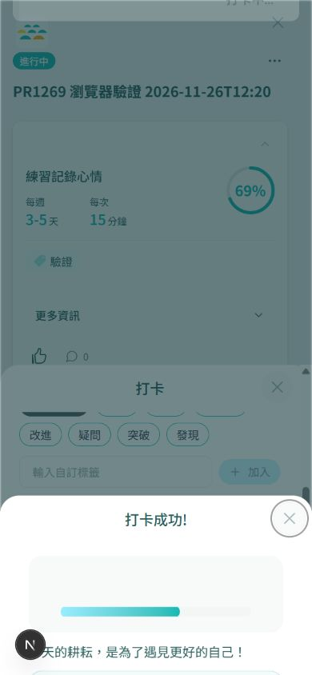
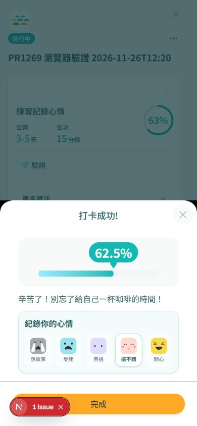
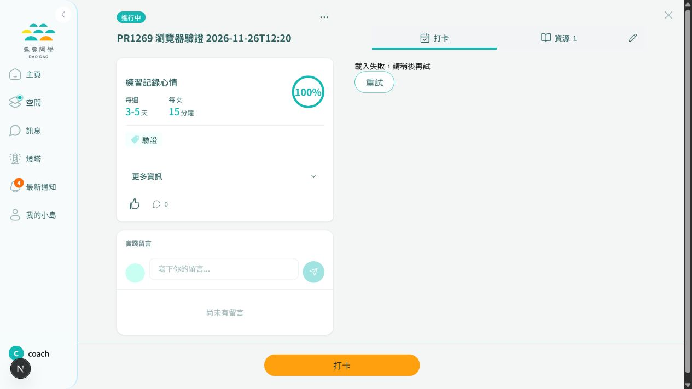

# Practice detail POC verification — 2026-11-26

This report records the PR #1269 follow-up on `feat/practice-detail-view-poc`, based on `6e755f7aa737231cb8be5b99d83c861dc800deae` plus the mood retry and initial-state corrections in the same commit as this report. Historical results in the handoff document remain historical.

## Runtime and boundaries

- Windows native local synthetic environment; no dev/production data was copied. The skill's Docker runtime helper does not support Windows and was not reported as passing.
- Product: this isolated worktree, Next 15.5.15, `localhost:3002`, explicitly listening on `localhost`. `/zh-TW/practices/<id>` redirected to the canonical Chinese `/practices/<id>` without a loop.
- Real local API: `localhost:13000`; PostgreSQL `127.0.0.1:15432`, Redis `127.0.0.1:16379`. API checkout is an existing dirty local integration based on server `668c2eaa9732ab4c2117a496fe5650c386724e06`, storage `6c8cda2bc562b9b8abc9f2e04031067eef76f2ac`. This is not a claim of current deployed-dev compatibility. No backend/schema changes were made.
- A task-owned loopback proxy on `13002` forwards ordinary browser calls to that real API. For specified error tests only, it returns a single synthetic HTTP 503 for a matching request. It does not mock successful writes or reads. The ignored generated API configuration was temporarily pointed to this proxy; no environment or credential files are committed.
- After a runtime restart, an additional IPv4 `127.0.0.1:3002` TCP forwarder connected the browser to the same Next listener on IPv6 `::1:3002`, preserving the `localhost` origin. Full typecheck and browser runs were serialized after the config build regenerated the ignored API setting. First-route compilation and browser reconnection timeouts were retried after inspecting the actual runtime; they are not counted as product passes.
- The existing browser session belongs to synthetic `coach` (`dcc0af58-97f2-4039-b849-4d061daeda63`). Dedicated owner practice: `0d211cf5-4843-4f6c-9ca5-286784bb19a1`. Dedicated public visitor practice, owned by a different synthetic account `assistant`: `02483c64-0bb9-454d-81ed-cda99c4106c0`. These fixtures were arranged through the existing authenticated API. Primary check-ins were created through the actual browser form.
- Browser interactions use the Codex in-app browser. No direct browser-storage/session manipulation, auth bypass route, or production credentials were added. `view=visitor` is presentation-only and is tested separately from true non-owner access.

## Observed corrections

1. A failed mood PUT formerly closed the success dialog before the write and left only a toast. The dialog now waits for the actual write, disables actions and dismissal while pending, retains the selected mood on failure, and retries the same check-in ID. The shared dialog action may return `false` to remain open; existing void-returning actions retain their behavior.
2. Page initialization formerly overwrote List with Bubbles for owners and overwrote the expanded overview with collapsed. Initialization now resets to List and expanded on a practice change.
3. The ordinary practice page formerly passed only the cohort query's error/retry state, making a failed normal check-in read look like an empty list with all-zero statistics. The page now passes the active query's error and mutate function, and hides statistics on read failure. The regression visibly showed 載入失敗，請稍後再試 and 重試; clicking 重試 restored the existing nine records and mood counts.

## Mood write and readback

The Chinese mobile journey used 390 × 844. Every newly opened success dialog showed five unchecked radio buttons and a native disabled 完成 button. A normal click while disabled did not close it. Selecting a radio with mouse or Space enabled completion without submitting automatically. Choosing 普通 also required that explicit selection. The next opening reset to unselected.

After completion, authenticated GET `/api/v1/practices/<id>/checkins` and an independent SQL SELECT joining `practice_checkins` to the dedicated practice returned these matching records:

| Check-in | Browser action | API and DB mood | Result |
| --- | --- | --- | --- |
| 1178 | 選開心 → 完成 | `happy` | PUT 200; reload list showed 開心 |
| 1180 | 選還不錯 → 完成; injected PUT 503 → repeat 完成 | `good` | Failure kept the dialog and selection; retry PUT 200 on ID 1180, one created record |
| 1181 | 明確選普通 → 完成 | `neutral` | No redundant PUT; existing neutral value matched API and DB |
| 1182 | 選想放棄 → 完成 | `give_up` | Real write and API/DB readback matched |
| 1183 | 選受挫 → 完成 | `frustrated` | Real write and API/DB readback matched |
| 1184 | 選開心 → 完成 | `happy` | Real write and API/DB readback matched |
| 1185 | 選開心 → Close | `neutral` | No mood PUT; previously created check-in retained its original neutral value |
| 1186 | POST 503 → retry preserved form → 選普通 → 完成 | `neutral` | One POST 201 after rejection; no duplicate record |
| 1191 | English Happy via Space, Tab, Enter | `happy` | PUT 200; reload showed Happy, authenticated API and DB agreed |

Record 1179 documents the pre-fix PUT 503 reproduction: it remained neutral after the dialog incorrectly closed. It is not counted as a successful mood save. The successful regression uses record 1180.

Required-field checks rejected an empty form with 請至少選擇一個標籤 and 請記下你的行動或觀察. The reflection question was visible directly; 換一題 changed it.

The injected POST 503 preserved the checked 新概念 tag and `PR1269 POST503 表單保留重試` description. Retrying the same form succeeded once. During the English mood PUT, all radios and Done became disabled and dismissal controls were removed; after reload the real stored Happy record remained.

## Responsive navigation and error journeys

- Checked owner and actual non-owner presentation in Chinese and English at mobile 390 × 844, tablet 768 × 1024 and desktop 1280 × 900. Dimensions were read back from the page. Mobile uses the list; tablet/desktop offer List/Bubbles with List initially selected. Both languages showed the actual different creator on the visitor practice and hid owner check-in/resource-edit controls.
- Owner and visitor mobile overview started expanded, collapsed to the expected summary and expanded again. Owner chevron and progress ring did not overlap in the captured expanded card. At the tested wider sizes the overview stayed expanded. The mobile visitor logo moved from y=20 to y=-480 during a page scroll, consistent with the intended scrolling behavior.
- Owner list expansion revealed older check-ins; switching to Bubbles rendered the existing records. A true visitor followed a bubble into check-in 1190, saw the other creator and mood without owner edit/check-in actions, and returned with 查看所屬實踐. The first detail-route compilation took about 83 seconds locally; navigation eventually completed with HTTP 200.
- Presentation preview `?view=visitor` on the owner practice retained the query in both list and bubble links into check-in 1186 and the parent-practice return link. This verifies presentation context, not another account's authorization.
- Chinese and English resource tabs showed the unscheduled 測試資源 without an all-period label.
- Private practice `5782465f-7a1d-4736-ac09-542a44b381e0`, owned by the other synthetic account, returned real HTTP 403 with `data: null`. The browser showed only 載入失敗，請稍後再試; its private title/action were absent. This is an existing authorization regression check, not a change to API permission policy.
- Injected GET check-ins 503 reproduced the incorrect empty statistics before the fix. After the fix, the browser displayed the error and 重試 without zero statistics; manual retry GET 200 restored nine records and the original mood distribution. The failure was controlled at the task proxy, not at a deployed backend.

## Reviewable evidence

Additional captures: [owner mobile](practice-detail-evidence-2026-11-26/owner-mobile-expanded.jpg), [owner tablet bubbles](practice-detail-evidence-2026-11-26/owner-tablet-bubbles.jpg), [visitor desktop](practice-detail-evidence-2026-11-26/visitor-desktop-bubbles.jpg), [visitor mobile](practice-detail-evidence-2026-11-26/visitor-mobile-expanded.jpg), [private read denial](practice-detail-evidence-2026-11-26/private-practice-denied.jpg), [English persisted record](practice-detail-evidence-2026-11-26/english-reloaded-record.jpg). [Sanitized HTTP and API/DB readback](practice-detail-evidence-2026-11-26/api-readback.json) contains no credentials or cookies.

## Automated checks

- Regression tests were first run against the old implementation: 7 failed / 2 passed, including early callback invocation, failure closing, and pending-action protection.
- After correction: 2 focused files / 13 tests passed. The tests cover all five initial/selected states, reset, cancellation, persistence, false-result retry and prevention of duplicate completion/dismissal during a pending write. They use a mocked manager and do not replace the browser evidence above.
- Biome check on the mood/default-state source/test files passed without warnings; the later page/shell read-error fix also passed Biome.
- Full workspace typecheck passed 18/18 after the mood/default-state corrections. The final product-only `tsc --noEmit` also passed (exit 0) after the later read-error wiring change.
- Full lint was attempted and remained blocked by unchanged `packages/blog-content` CRLF formatting. Unrelated files were not reformatted.

## Limits and handoff

This is local POC browser/API evidence, not deployed-dev acceptance, a cross-browser certification or a claim that all cohort/admin/comment/reaction flows were exercised. The old synthetic API still returns a Chinese encouragement sentence in the English success dialog; English UI labels and mood persistence were verified, but server-generated content localization needs confirmation against the current deployed API. Owner collapse behavior outside active status and integration with the latest dev remain engineering review items.

Only task-created preview/proxy/forwarder processes were stopped, and the ignored generated environment configuration was restored. The dedicated synthetic practices/check-ins were retained for reproducibility; existing fixtures/services were not changed. No auth tokens, login helpers, environment overrides, or backend edits are part of the PR. Keep PR #1269 draft; no multi-engine review, merge or production deployment was performed.

Prevention: the regression tests now intercept premature completion and duplicate pending writes, while the browser error checks distinguish failed reads from empty data. These checks supplement each other; a unit-test pass alone is not the journey evidence.
